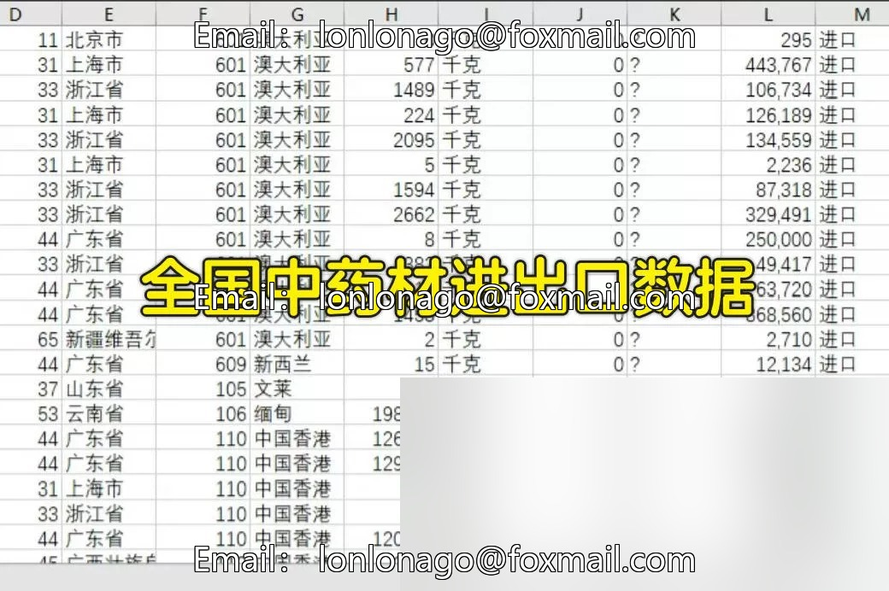
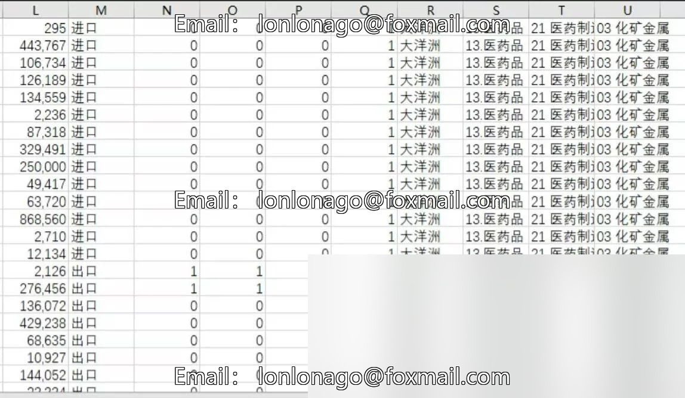

# National traditional Chinese medicine import and export data; animal, plant, and mineral-source Chinese patent medicines - angelica sinensis, nancedi, oxalic acid, chrysanthemum, and chrysodium

## Body

National Chinese medicinal materials import and export data
Containing import and export quantities, amounts

Source: China Guanggu database / Ministry of Commerce International Trade Division
Data scope: Trade data of 31 provinces nationwide, with detailed breakdowns for each, covering global countries and countries of the world
Data period: 2015-2024, in RMB yuan
Additional increments: yidaiyilu national sign, ASEAN country sign, EU country sign, RCEP country sign, and the continents it belongs to, for easy statistical analysis and utilization in different scenarios.

Main variables:

Year | Product code | Product name | Registered location code | Registered location name | Trade partner code | Trade partner name | First quantity | First measuring unit | Second quantity | Second measuring unit | RMB | Import and export flag | 1dai1lu national flag | ASEAN national flag | EU national flag | RCEP national flag | Continent of origin | Corresponding ISO industry classification

Corresponding industrial industry code name  
Industry seven-category code name

Details classification:
Powder and waste of shell of soft-bodied, arthropod, echinoderm, and squid bone, and inkfish bone.
Coral and similar items; shells of soft-bodied, crustacean or polyps, squid bone
Dandalwood scent, beaver scent, and spirit cat scent
Myrmecion
Fresh or dry wild ginseng (except Siberian ginseng)
Other fresh ginseng
Mahuang
Coptis chinensis
……

web-based shipment, can be directly photographed and shipped.

The data covers 31 provinces nationwide and global countries, spanning 2015-2024, including import and export quantities and amounts, with dimensions for countries, regions and industries.

<!-- AI_ENRICHED -->

## Images

## Payment

Here is a pay link on Stripe ( https://buy.stripe.com/3cs8yP7sY87d0vu9AB ). Please contact me lonlonago@foxmail.com after funding $89, and I will send you a complete data files , thank you!

